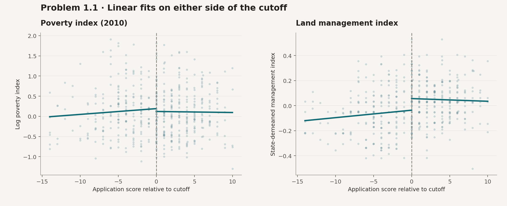
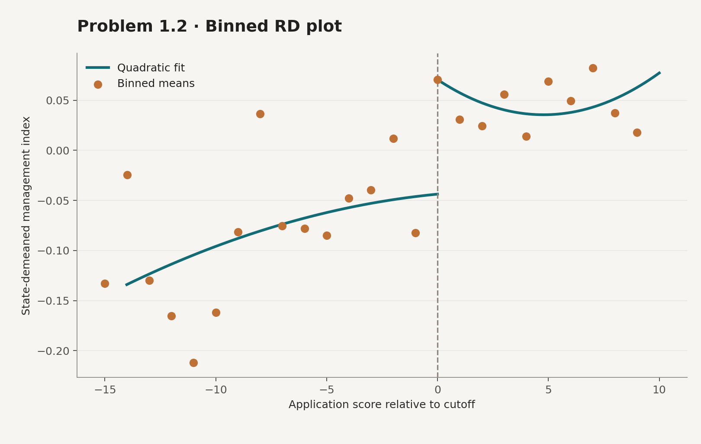

# 3. Conservation payments in Mexico

This project looks at whether eligibility for conservation payments changes land management. The class data has 502 localities from the 2013–14 cohort, the application score is centered so that zero is the state eligibility cutoff. A score of zero or higher means the locality was eligible.

I used R to plot the poverty measure from before the program and the land management outcome on both sides of the cutoff. For the management plot I subtract the state average (the regression comparison script uses the raw index. The binned plot uses the average outcome in each bin for the dots, the curves are fit on the locality-level data.





The thing I’m looking for is a jump at the cutoff. If the usual RD assumptions hold, that jump captures the effect of eligibility near zero. actual participation is a different variable so an estimate for taking up the program would also use the jump in uptake.

The [plot script](rd-plot.R) and [model comparison](rd-specifications.R) use `data/mexico_localities.dta` from the course. The scripts use `tidyverse`, `haven`, `patchwork` and `broom`. Run these from the repository root after adding the data and packages.

```sh
Rscript rd-plot.R
Rscript rd-specifications.R
```

The figures here are previews from the coursework. The scripts still need a fresh run for the estimates table.

Source — Alix-Garcia and colleagues (2018), [Payments for environmental services supported social capital while increasing land management](https://pmc.ncbi.nlm.nih.gov/articles/PMC6142241/).
