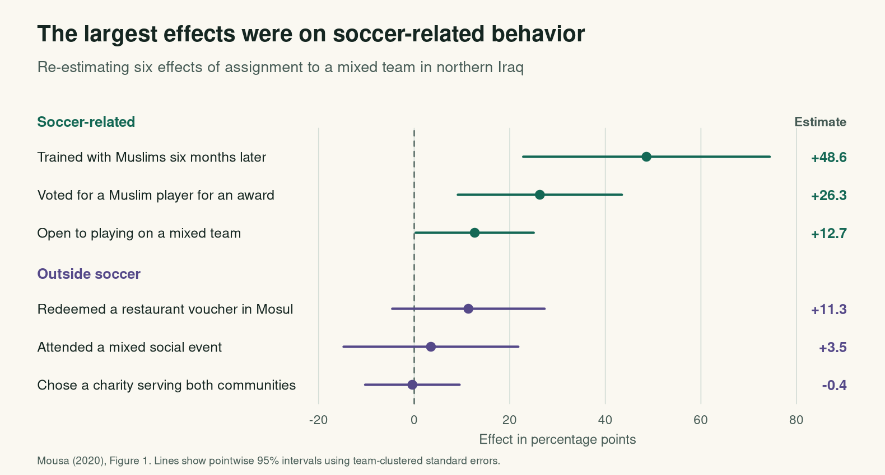
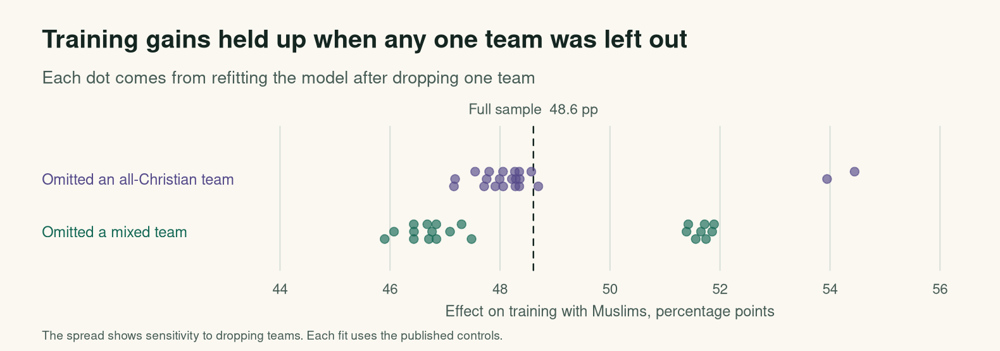

# Can playing on the same team change what people do off the field?

*An R replication exercise on intergroup contact in post-ISIS Iraq*

I wanted to start with a question that sounds simple until you have to measure it. If you spend a season playing soccer alongside someone from a different religious community, does that change what you do when you go back to your ordinary life, or is the change mostly in how you deal with people you met through the league? I used Salma Mousa’s experiment in northern Iraq to work through that distinction, rebuilding the treatment-effect panel of Figure 1 from the archived data and then checking how much the training result depends on any one team. [Mousa (2020), *Science*](https://doi.org/10.1126/science.abb3153) · [Replication archive](https://doi.org/10.5281/zenodo.3942437)

## What was randomized

Mousa paired teams that gave similar baseline answers about how much they had in common with Sunni Arabs, then randomized which team in each pair would receive Muslim teammates and which would receive additional Christian teammates. The main analysis follows Christian participants, and both groups played in the same experimental leagues, where a player on an all-Christian team could still encounter Muslim opponents. That comparison gives us an estimate of what changed when the other players were **teammates** in a setting where both groups were already playing soccer. [Study, pp. 866–867](https://poverty-action.org/sites/default/files/publications/Building-social-cohesion-between-Christians-and-Muslims-through-soccer-in-post-ISIS-Iraq.pdf)

The rows in the data represent players, but the assignment happened at the team level, so I used team-clustered standard errors to account for the fact that two players on the same team shared an assignment and could respond in similar ways. I fit a linear probability model for each binary outcome, which lets me read the coefficient on `treated` in percentage points after multiplying by 100. The script uses the outcome-specific samples and controls in Mousa’s archive, including randomization-block indicators where her Figure 1 specification uses them. [Archived analysis script](https://zenodo.org/records/3942437/files/main-analyses.R?download=1)

## Rebuilding the treatment effects



| Outcome | Effect (pp) | 95% CI (pp) | Players | Teams |
| --- | ---: | ---: | ---: | ---: |
| Trained with Muslims six months later | +48.6 | [22.8, 74.4] | 459 | 42 |
| Voted for a Muslim player for an award | +26.3 | [9.1, 43.5] | 183 | 28 |
| Open to playing on a mixed team | +12.7 | [0.3, 25.0] | 232 | 28 |
| Redeemed a restaurant voucher in Mosul | +11.3 | [−4.6, 27.3] | 318 | 28 |
| Attended a mixed social event | +3.5 | [−14.8, 21.8] | 459 | 42 |
| Chose a charity serving both communities | −0.4 | [−10.3, 9.5] | 221 | 28 |

The training estimate comes out to **48.6 percentage points**, which rounds to the 49 reported in the paper, and I get the same rounded match for the award vote and willingness to join a mixed team. The restaurant voucher gives a good example of how I’d read the other side of the figure, because the estimate is positive at 11.3 points, but its interval runs from a small decline to an increase of more than 27 points. I’d describe that result as imprecise, and if I wanted to make a statistical claim about the gap between soccer-related and other outcomes I’d need a direct test of that difference, which Mousa reports separately in Figure 2. [Published figures](https://poverty-action.org/sites/default/files/publications/Building-social-cohesion-between-Christians-and-Muslims-through-soccer-in-post-ISIS-Iraq.pdf) · [Computed results](figure-1-effects.csv)

## What happens if I drop one team?

I took the largest estimate and reran the same training model 42 times, removing the players on one team per run, because an effect this large would be harder to interpret if it depended on one team with an extreme result. The estimates ran from **45.9 to 54.4 percentage points**, a fairly narrow range around the full-sample estimate, which I read as a check on the influence of any single team while keeping the full-sample confidence interval for statistical uncertainty. [All 42 re-estimates](training-leave-one-team-out.csv)



## Try the calculation

Use the two raw percentages for `train_t1` in the results CSV to calculate the unadjusted difference, then compare it to the model estimate in the same row. The two numbers use the same 459 players, so the gap is a way to see what the covariate adjustment changes in this specification.

```r
effects <- read.csv("figure-1-effects.csv")
training <- subset(effects, variable == "train_t1")
with(training, observed_treated_pct - observed_control_pct)
# 43.48 percentage points before adjustment, compared with 48.61 after adjustment
```

## Reproduce the exercise

Run `Rscript analysis.R` in this directory with base R and Cairo PNG support, and the script will download and verify the three Zenodo v1 inputs before recreating both plots and both tables. If you’ve downloaded the CSVs yourself, run `Rscript analysis.R /path/to/csv-directory`. [R script](analysis.R) · [Source data and codebook](https://doi.org/10.5281/zenodo.3942437)

The analysis keeps the binary variables as stored in the CSVs, following the archived script and the direction of the plotted outcomes in the paper, since some of the 0/1 descriptions in the separate PDF codebook run the other way. The confidence intervals are pointwise 95% intervals using the normal critical value and team-clustered standard errors, as in the original figure. AI assisted with the R implementation and editing for this portfolio exercise.
