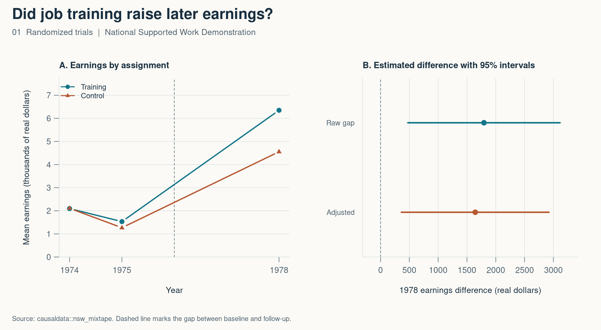

# 1. Did job training raise later earnings?

*Mastering ’Metrics, chapter 1 · Randomized trials*

If someone finishes a job program and earns more a year later, it could be the program or it could be that the people who signed up were already on a different path. A randomized comparison gives us a way to answer the question without having to model every difference between people.

I used the experimental National Supported Work sample in `causaldata::nsw_mixtape`. The program offered subsidized work and support, so the comparison is about that bundle. There are 185 people in the training group and 260 in the control group, with 1978 earnings observed for all 445 in this extract.



## The comparison

Random assignment lets the control group stand in for the earnings the training group would have had without the program. It makes the groups comparable in expectation, and a given sample can still differ at baseline. The standardized gap in schooling is 0.14 standard deviations here, and the gap in 1974 earnings is close to zero.

| 1978 earnings comparison | Difference in real dollars | 95% interval |
| --- | ---: | ---: |
| Training minus control | +$1,794 | $474 to $3,115 |
| Adjusted for age, schooling, and prior earnings | +$1,643 | $362 to $2,924 |

The simple comparison comes from means of $6,349 and $4,555. I use a Welch interval for that gap and a heteroskedasticity-robust interval for the adjusted estimate. The result concerns this sample and this version of the program. A different job placement program could have a different effect.

```r
comparison <- t.test(trained$re78, control$re78)
mean(trained$re78) - mean(control$re78)
comparison$conf.int
```

[Full R script](01-randomized-trials.R) · [Results CSV](01-results.csv) · [Baseline balance CSV](01-balance.csv)

Sources — Robert LaLonde (1986), “Evaluating the Econometric Evaluations of Training Programs with Experimental Data,” and the Dehejia–Wahba experimental extract distributed in [causaldata](https://github.com/NickCH-K/causaldata).

