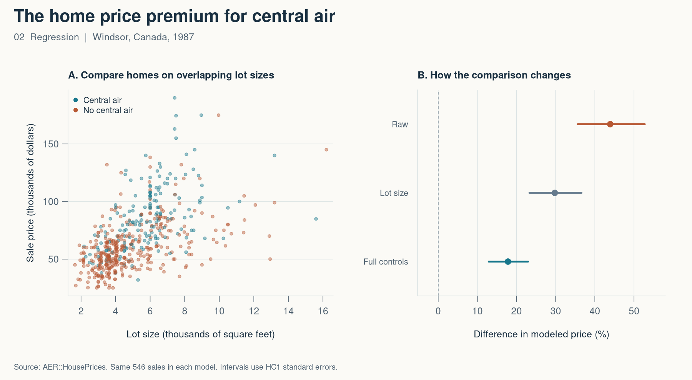

# 2. How much more did homes with central air sell for?

*Mastering ’Metrics, chapter 2 · Regression and omitted variables*

When I compare two listings, I want to know what feature I’m paying for. Homes with central air can also sit on bigger lots or have more bathrooms. A comparison of average sale prices picks up all of those differences together.

I used 546 home sales in Windsor, Canada, from July through September 1987. The outcome is log sale price. I fit three models on the same sales so a change in the estimate comes from adding controls, with the sample held fixed.



| Controls | Modeled price difference | 95% interval |
| --- | ---: | ---: |
| None | +43.9% | 35.6% to 52.8% |
| Log lot size | +29.8% | 23.3% to 36.6% |
| Lot size and property features | +17.8% | 12.9% to 23.0% |

The percentages come from `100 * expm1(coefficient)`, which gives the ratio of modeled geometric mean prices on a percentage scale. The central-air homes had lots averaging 5,856 square feet, compared with 4,823 for the other homes. Lot size is positively related to price, so leaving it out pushes the raw air-conditioning coefficient up. The script checks that omitted-variable-bias identity directly.

The full model adds bedrooms, bathrooms, stories, garage capacity, and a preferred-neighborhood indicator. The 17.8% is a conditional association. Things like renovation quality and interior living area can still differ between the houses, and comparisons are most credible where their observed characteristics overlap.

```r
full <- lm(log(price) ~ central_air + log(lotsize) + bedrooms +
             bathrooms + stories + garage + prefer, data = homes)
100 * expm1(coef(full)[["central_air"]])
```

[Full R script](02-regression.R) · [Results CSV](02-results.csv)

Source — P. Anglin and R. Gencay (1996), “Semiparametric Estimation of a Hedonic Price Function,” *Journal of Applied Econometrics*. The script loads `AER::HousePrices`. [Original data archive](http://qed.econ.queensu.ca/jae/1996-v11.6/anglin-gencay/)

