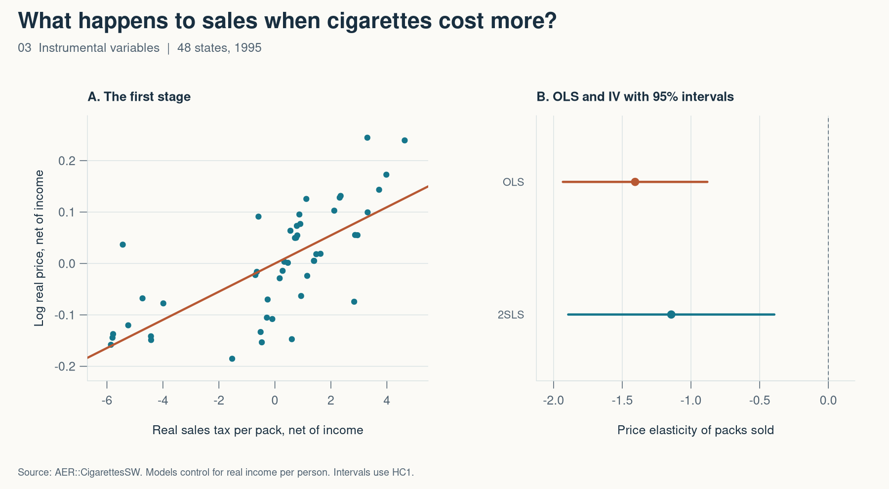

# 3. What happens to sales when cigarettes cost more?

*Mastering ’Metrics, chapter 3 · Instrumental variables*

A simple regression of sales on price has a problem. Local demand can affect what stores charge, even as prices affect how much people buy. I used sales taxes to isolate a source of price variation and asked what happened to packs sold per person.

The data are for 48 continental states in 1995. I deflated price, income, and the sales tax component by the CPI. Both models control for log real income per person. The outcome is log packs sold per capita.



## Three steps in the IV calculation

1. **First stage.** Higher sales taxes predict higher real prices. The sales tax slope in the log price equation is 0.0274, with a one-instrument robust first-stage F statistic of 44.7.
2. **Reduced form.** The slope on the same tax variable in the log sales equation is −0.0313.
3. **2SLS.** Dividing the reduced-form slope by the first-stage slope gives −1.14. The script checks that this ratio equals the 2SLS coefficient.

| Model | Price elasticity | 95% interval |
| --- | ---: | ---: |
| OLS | −1.41 | −1.93 to −0.88 |
| Tax-instrumented 2SLS | −1.14 | −1.89 to −0.39 |

An elasticity of −1.14 corresponds to about 1.14% fewer packs sold per person for a 1% higher price. The causal reading requires tax differences to be unrelated to other demand shocks after conditioning on income and to affect sales through price. States can also differ in antismoking policies, and recorded sales can move when people shop across state lines. The estimate summarizes the response of recorded sales to the price variation induced by this instrument.

```r
first_stage <- lm(log_price ~ sales_tax + log_income, data = cig)
reduced_form <- lm(log_packs ~ sales_tax + log_income, data = cig)
coef(reduced_form)[["sales_tax"]] / coef(first_stage)[["sales_tax"]]
```

[Full R script](03-instrumental-variables.R) · [Results CSV](03-results.csv)

Source — James H. Stock and Mark W. Watson, *Introduction to Econometrics*, 2nd ed. (2007). The script loads `CigarettesSW` from [AER](https://cran.r-project.org/package=AER).

