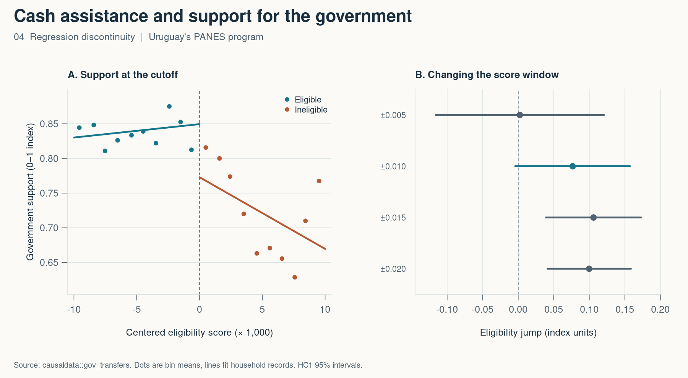

# 4. Does qualifying for cash assistance change political support?

*Mastering ’Metrics, chapter 4 · Regression discontinuity*

Two households can have almost the same income score and end up on different sides of a benefit rule. Support for the government can also vary with income, so I want to compare the closest households on either side and see if support jumps where eligibility changes.

I used the public teaching extract of Uruguay’s PANES cash-assistance program. A centered score below zero makes the household eligible. In this extract, all 1,127 eligible households participated and all 821 ineligible households did not. The outcome is a government-support index on a 0–1 scale.



## Fit the two sides separately

Within a window of ±0.010 in the original score units, I fit a separate line on each side and compare the two predictions at zero. There are 937 households in that window. The fitted values are 0.8495 on the eligible side and 0.7729 on the other side, giving a jump of 0.077 index units.

| Score window around cutoff | Households | Estimated jump | 95% interval |
| --- | ---: | ---: | ---: |
| ±0.005 | 462 | +0.002 | −0.116 to +0.121 |
| **±0.010** | **937** | **+0.077** | **−0.004 to +0.157** |
| ±0.015 | 1,425 | +0.106 | +0.039 to +0.173 |
| ±0.020 | 1,948 | +0.100 | +0.041 to +0.159 |

The narrow window uses the closest comparisons and gives a wide interval. Wider windows bring in more households and rely more on the linear fit. A causal interpretation requires expected support without the program to vary smoothly with income at the cutoff. Precise sorting around the score or another benefit triggered at the same point would give reason to doubt that comparison. The estimate concerns households near the threshold.

```r
near <- subset(households, abs(score) <= 10)  # score is rescaled by 1,000
rd <- lm(support ~ eligible * score, data = near)
coef(rd)[["eligible"]]
```

[Full R script](04-regression-discontinuity.R) · [Results CSV](04-results.csv)

Source — Marco Manacorda, Edward Miguel, and Andrea Vigorito (2011), “Government Transfers and Political Support,” *American Economic Journal: Applied Economics*. The script uses `causaldata::gov_transfers`. [Original paper](https://doi.org/10.1257/app.3.3.1)

