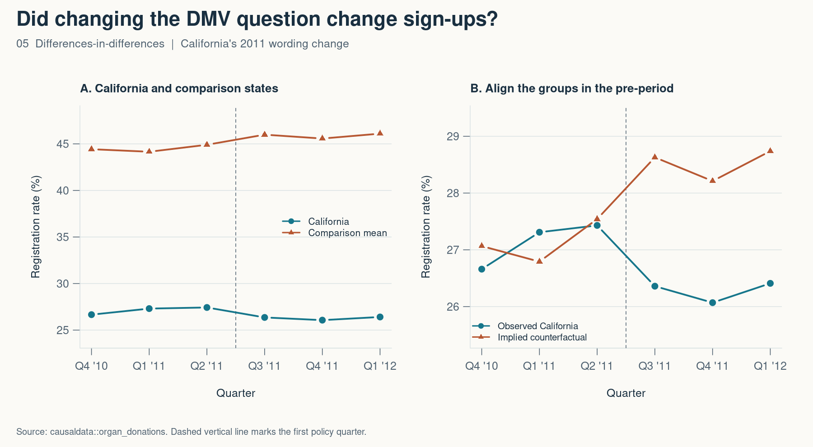

# 5. Did changing a DMV question change donor sign-ups?

*Mastering ’Metrics, chapter 5 · Differences-in-differences*

When a form asks you to make a choice, even a change in wording might matter. California moved to an active-choice prompt for organ donor registration in the third quarter of 2011. I looked at how its registration rate changed relative to states in the comparison sample.

I used six quarters from 2010 Q4 through 2012 Q1 for California and 26 comparison states. Each state receives equal weight in the comparison. There are three quarters before the change and three after it.



| Group | Before | After | Change |
| --- | ---: | ---: | ---: |
| California | 27.13% | 26.28% | −0.85 pp |
| Comparison states | 44.49% | 45.89% | +1.39 pp |
| **Difference-in-differences** |  |  | **−2.25 pp** |

The right panel shows the counterfactual behind the subtraction. I shift the comparison path by the average pre-policy gap, then ask how far California ends up from that path after the change. The regression with state and quarter fixed effects gives the same −2.25 percentage point estimate as the four means.

The assumption is that, without the new prompt, California’s rate would have changed by the same amount as the comparison mean. The three pre-policy quarters offer a short view of that trend, and California is the only treated state. I report the point estimate and check how it changes when I leave out each comparison state. The range is −2.43 to −1.77 percentage points across those checks.

```r
fit <- lm(rate_pp ~ factor(State) + factor(Quarter_Num) + treated:post,
          data = donors)
coef(fit)[["treated:post"]]
```

[Full R script](05-differences-in-differences.R) · [Four-means CSV](05-results.csv) · [Sensitivity CSV](05-leave-one-out.csv)

Source — Judd Kessler and Alvin Roth (2014), “Don’t Take ‘No’ for an Answer: An Experiment with Actual Organ Donor Registrations.” The script uses `causaldata::organ_donations`. [Original working paper](https://www.nber.org/papers/w20378)

